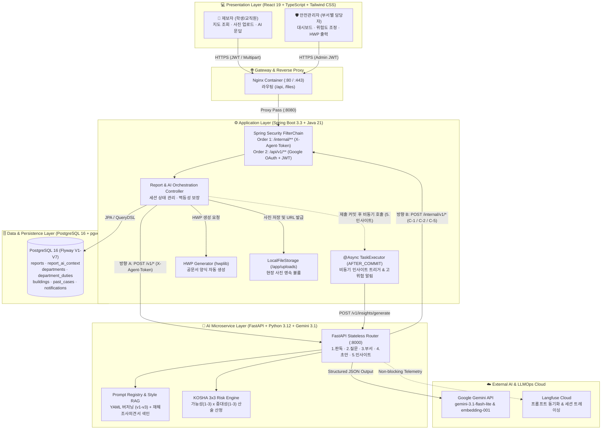
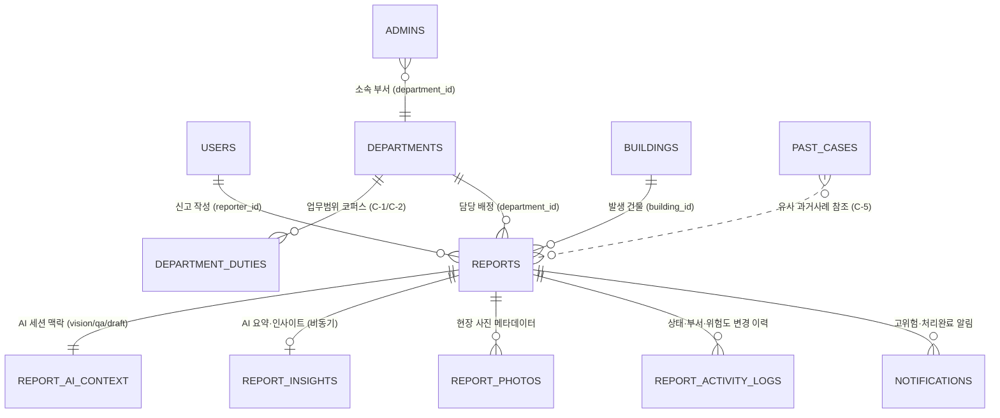

# 🐋 안전고래 (SafeWhale) — AI 기반 캠퍼스 안전신고 및 위험성평가 플랫폼
### [안전고래 솔루션] 개발 프로젝트 결과보고서

> "**사진 한 장과 짧은 제보만으로 현장 위험요소를 판독하고, KOSHA 표준 위험성평가(3×3)와 공문서(HWP) 초안 작성 및 담당 부서 배정까지 자동화하는 지능형 캠퍼스 안전관리 플랫폼**"

[](https://github.com/SafeWhaleArtechSogang)
[](#ii-개발-환경-및-파트별-기술-스택-tech-stack)
[](#ii-개발-환경-및-파트별-기술-스택-tech-stack)
[](#ii-개발-환경-및-파트별-기술-스택-tech-stack)
[](#ii-개발-환경-및-파트별-기술-스택-tech-stack)
[](#ii-개발-환경-및-파트별-기술-스택-tech-stack)

---

## 📋 목차 (Table of Contents)

1. [**I. 프로젝트 개요**](#i-프로젝트-개요)
   - 1. 추진 배경 및 필요성
   - 2. 프로젝트 목표 및 핵심 가치
2. [**II. 개발 환경 및 파트별 기술 스택 (Tech Stack)**](#ii-개발-환경-및-파트별-기술-스택-tech-stack)
   - 1. 파트별 기술 스택 요약 배지
   - 2. 파트별 상세 프레임워크·라이브러리 명세
   - 3. Organization 레포지토리 구조
3. [**III. 전체 시스템 아키텍처 및 작동 흐름도 (System Workflow)**](#iii-전체-시스템-아키텍처-및-작동-흐름도-system-workflow)
   - 1. 인프라 및 컨테이너 토폴로지
   - 2. 전체 서비스 흐름도 (End-to-End Flowchart)
   - 3. 데이터베이스 ERD 설계
4. [**IV. AI 서버 작동 흐름도 및 핵심 엔지니어링 (AI Pipeline)**](#iv-ai-서버-작동-흐름도-및-핵심-엔지니어링-ai-pipeline)
   - 1. 5단계 AI 파이프라인 전체 흐름도 (AI Workflow Flowchart)
   - 2. 단계별 AI 모듈 상세 및 백엔드 내부 연동 (C-1 · C-2 · C-5)
   - 3. KOSHA 빈도·강도법(3×3) 기반 결정론적 위험성평가 표준화
   - 4. 고용노동부 재해조사의견서 기반 문체 RAG (Style RAG)
5. [**V. 주요 기능 및 테스트·검증 결과**](#v-주요-기능-및-테스트검증-결과)
   - 1. 제보자(학생·교직원) 및 관리자 핵심 기능
   - 2. End-to-End 파이프라인 성능 실측 및 검증
6. [**VI. 결론 및 향후 기대효과**](#vi-결론-및-향후-기대효과)

---

## I. 프로젝트 개요

### 1. 추진 배경 및 필요성
대학 캠퍼스 내 시설물 파손, 보행로 침하, 전기·소방 설비 불량 등 다양한 유해·위험요인이 상시 발생하고 있으나, 기존의 안전신고 절차는 다음과 같은 구조적 한계를 지니고 있습니다.

* **신고 작성의 진입장벽**: 일반 학생이나 교직원이 정확한 시설물 명칭, 위험 인과관계, 요구되는 조치 사항을 공문서 수준으로 작성하기 어렵습니다.
* **부서 배정 및 초기 대응 지연**: 시설팀(`FACILITY`), 안전관리센터(`SAFETY_CENTER`), 인사총무팀(`GENERAL_AFFAIRS`) 등 소관 부서가 세분화되어 있어 담당 부서 판정과 이관에 행정 지연이 발생합니다.
* **위험도 산정의 주관성 및 행정 재작업**: 접수된 신고를 고용노동부·안전보건공단(KOSHA) 기준의 **위험성평가 결과서**(가능성 × 중대성) 및 **한글 보고서**(HWP)로 변환하는 과정에서 안전담당자의 수작업 부담과 주관적 편차가 발생합니다.

### 2. 프로젝트 목표 및 핵심 가치
**안전고래**(SafeWhale)는 위 문제를 해결하기 위해 **멀티모달 LLM**(Gemini)과 **규칙 기반 결정론적 검증 엔진**을 결합한 AI 안전신고 플랫폼으로 설계되었습니다.

1. **대화형 AI 챗봇 신고 플로우**: 현장 사진 1장과 한 줄 설명만 업로드하면 AI가 객체를 판독하고, 부족한 현장 맥락(지속 기간, 통행량, 임시조치 유무 등)을 3단계 맞춤형 객관식 질문으로 수집합니다.
2. **책임 분리형 하이브리드 AI 아키텍처**: LLM은 **관측과 문장 생성**에만 집중하고, 위험 등급 산출(**KOSHA 3×3 빈도·강도법 곱셈**)과 담당 부서 최종 확정(**임계값 0.7 검증 및 Fallback**)은 코드와 백엔드 DB가 결정론적으로 수행합니다.
3. **행정 자동화** (Style RAG & HWP 생성): 고용노동부 재해조사의견서 문체를 참조하는 **문체 RAG**로 10개 항목의 개조식 초안을 작성하고, 즉시 다운로드 가능한 **HWP 공문서 양식**과 관리자용 **유사 과거사례 인사이트**를 자동 생성합니다.

---

## II. 개발 환경 및 파트별 기술 스택 (Tech Stack)

### 1. 파트별 기술 스택 요약 배지

#### 🎨 Frontend (`frontend`)


#### ⚙️ Backend (`backend`)


#### 🧠 AI Server (`ai-server`)


#### 🗄️ Database & Storage


#### 🚀 Infrastructure & DevOps


---

### 2. 파트별 상세 프레임워크·라이브러리 명세

| 파트 | 구분 | 채택 기술 및 버전 | 도입 목적 및 주요 역할 |
| :--- | :--- | :--- | :--- |
| **Frontend** | Core / UI | `React 19.2`, `TypeScript 6.0`, `Vite 8.0` | 캠퍼스 안전신고 웹앱(학생용 챗봇·지도 UI) 및 관리자 대시보드 SPA 구현 |
| **Frontend** | Styling / Routing | `Tailwind CSS 4.3`, `React Router 7.15`, `Lucide React` | 반응형 모바일/데스크톱 UI 스타일링 및 권한별(Guest/User/Admin) 라우팅 |
| **Backend** | Core Framework | `Java 21 (Eclipse Temurin)`, `Spring Boot 3.3.13` | 외부 공개 단일 진입점 API 서버, 신고 세션/상태 관리, AI 오케스트레이션 |
| **Backend** | ORM / DB Migration | `Spring Data JPA`, `QueryDSL 5.1`, `MapStruct 1.6`, `Flyway` | 동적 필터링/검색 쿼리 최적화, DTO 매핑 자동화, 스키마 버전 형상관리(`V1`–`V7`) |
| **Backend** | Security / Auth | `Spring Security`, `JJWT 0.12.6`, `Google API Client 2.9` | Google ID Token 검증 기반 소셜 로그인, 관리자 인증, `/internal/**` 전용 `X-Agent-Token` 이중 필터체인 |
| **Backend** | Document / Media | `hwplib 1.1.10`, `metadata-extractor 2.19.0`, `SpringDoc OpenAPI 2.6` | 신고서 HWP 공문서 파일 동적 생성, 업로드 사진 EXIF 메타데이터 추출, Swagger API 문서화 |
| **AI Server** | Core / Web | `Python 3.12-slim`, `FastAPI 0.115+`, `Uvicorn`, `Pydantic 2.7` | 무상태(Stateless) AI 전용 마이크로서비스 (Dify 의존성 제거 및 경량 자체 구현) |
| **AI Server** | LLM / RAG | `google-genai 1.20+` (`gemini-3.1-flash-lite`, `gemini-embedding-001`) | 구조화 JSON 스키마(`response_json_schema`) 출력 강제, 비전 판독 및 문체 RAG 임베딩 검색 |
| **AI Server** | LLMOps / Prompt | `PyYAML 6.0`, `Langfuse 3.0+`, `HTTPX 0.27` | 프롬프트 YAML 버전 관리(`v1`–`v3`), 실시간 A/B 버전 주입, 토큰·지연시간 트레이싱 및 폴백 |
| **Database** | DBMS | `PostgreSQL 16` (`pgvector/pgvector:pg16`) | 신고·건물·부서·과거사례·AI 컨텍스트(`report_ai_context`) 저장 및 유사도 검색 |
| **DevOps** | Container / Cloud | `Docker Compose`, `Nginx`, `AWS EC2 (t3.micro + Swap 2GiB)`, `GHCR` | 멀티 스테이지 도커 빌드, 내부망 컨테이너 격리(`ai:8000` 비공개), 메모리 상한(`160m`) 최적화 배포 |

---

### 3. Organization 레포지토리 구조

```text
📦 SafeWhaleArtechSogang (Organization Workspace)
 ┣ 📂 frontend/                 # React 19 + TypeScript + Tailwind CSS 4 프론트엔드
 ┃ ┣ 📂 src/                    # 제보자용 지도·AI 챗봇 UI 및 관리자 대시보드 화면
 ┃ ┗ 📜 package.json
 ┣ 📂 backend/                  # Java 21 + Spring Boot 3.3 백엔드 API 서버
 ┃ ┣ 📂 src/main/java/          # 도메인(Report, Building, Department, Auth, Admin, AI 연동)
 ┃ ┣ 📂 src/main/resources/db/  # Flyway DB 마이그레이션 스크립트 (V1 ~ V7)
 ┃ ┣ 📜 Dockerfile              # Multi-stage JRE 21 Alpine 이미지 빌드
 ┃ ┗ 📜 compose.yaml            # Backend + PostgreSQL 16 (pgvector) 구성
 ┣ 📂 ai-server/                # Python 3.12 + FastAPI + Gemini 무상태 AI 서버
 ┃ ┣ 📂 app/apps/               # 5대 핵심 AI 엔드포인트 모듈 (a1_vision ~ a5_insight)
 ┃ ┣ 📂 app/prompts/            # 노드별 프롬프트 YAML 버전 저장소 및 Langfuse 로더
 ┃ ┣ 📂 app/rag/                # 고용노동부 재해조사의견서 기반 문체 RAG 엔진 및 색인
 ┃ ┣ 📂 app/backends/           # Spring 내부 API(C-1/C-2/C-5) HTTP & Stub 클라이언트
 ┃ ┣ 📜 Dockerfile              # Multi-stage Python 3.12-slim 경량 이미지 (mem_limit: 160m)
 ┃ ┗ 📜 compose.yaml
 ┗ 📂 specification/            # 아키텍처 설계서, API 명세서, DB 설계서, AI 고도화 기술 보고서
```

---

## III. 전체 시스템 아키텍처 및 작동 흐름도 (System Workflow)

### 1. 인프라 및 컨테이너 토폴로지
안전고래는 **보안성과 장애 격리**를 위해 외부 트래픽이 AI 서버나 DB에 직접 닿지 않도록 설계되었습니다.
* **단일 진입점** (Single Entrypoint): 클라이언트(브라우저)는 오직 `Nginx` → `Spring Boot Backend (:8080)` 경로로만 통신하며 `JWT`로 인증합니다.
* **내부망 AI 격리**: `AI Server (:8000)`는 외부 포트를 열지 않고(`expose` 전용) Docker 내부 네트워크에서 `Backend`와만 양방향 대칭 토큰(`X-Agent-Token`)으로 통신합니다.
* **무상태 AI 설계** (Stateless): AI 서버는 DB 커넥션이나 세션을 보유하지 않으며, 모든 대화 맥락(`report_ai_context`)은 `Spring Backend`가 관리합니다.

### 2. 전체 서비스 흐름도 (End-to-End Flowchart)



---

### 3. 데이터베이스 ERD 설계



---

## IV. AI 서버 작동 흐름도 및 핵심 엔지니어링 (AI Pipeline)

### 1. 5단계 AI 파이프라인 전체 흐름도 (AI Workflow Flowchart)
초기 프로토타입의 Dify 워크플로 엔진 의존성을 완전히 제거하고, **5개의 독립된 FastAPI 엔드포인트 모듈**(`a1`–`a5`)과 **Spring 내부 API**(`C-1`, `C-2`, `C-5`)의 양방향 오케스트레이션으로 재설계했습니다.

```mermaid
flowchart TD
    Start(["📸 0. 제보자: 현장 사진 + 위치 + 부연설명 업로드"]) --> Step1

    subgraph S1["1단계: 사진 판독 (POST /v1/vision/analyze · a1_vision.py)"]
        Step1["멀티모달 입력 결합<br/>(제보자 설명 우선 원칙 + 첨부 이미지)"]
        V_LLM["Gemini Vision 판독 (vision/v3)<br/>설계 구조물·촬영 아티팩트 배제"]
        V_Out["VisionResult 생성<br/>detected_hazard · photo_analysis · risk<br/>exposed_target · object_confidence"]
        Step1 --> V_LLM --> V_Out
    end

    V_Out --> ConfCheck{"질문 1회차 및<br/>object_confidence 0.7 미만?"}

    subgraph S2["2단계: 맞춤형 확인 질문 생성 (POST /v1/questions/next x 3회 · a2_question.py)"]
        ConfCheck -->|"Yes (객체 불확실)"| ObjCheck["객체 확인 질문 노드 (object_check/v1)<br/>판독 명칭 vs 혼동 후보 vs 잘 모르겠어요"]
        ConfCheck -->|"No (객체 명확 / 2-3회차)"| AxisRot["질문 축 로테이션 (question/v2)<br/>9개 축(sensory, onset, recurrence, traffic,<br/>temporary_action, scale, cause, impact, access)<br/>중 기사용 축 제외 후 선택"]
        ObjCheck --> FixOpt["선택지 보정기 (fix_options)<br/>중복 제거 · 정확히 3개 보장"]
        AxisRot --> FixOpt
        FixOpt --> QA_Acc["제보자 답변 수집 (3회 반복)<br/>report_ai_context.qa_json Upsert"]
    end

    QA_Acc --> Step3_Start

    subgraph S3["3단계: 담당 부서 판정 (POST /v1/departments/classify · a3_department.py)"]
        Step3_Start["판독 결과 + 위치 기반 검색 질의 조립"]
        C1["[방향 B: C-1] POST /internal/v1/rag/duty-search<br/>부서별 업무범위(department_duties) Top-8 검색"]
        D_LLM["부서 분류 LLM (department/v1)<br/>후보 비교 후 부서코드 + confidence 산출"]
        C2["[방향 B: C-2] POST /internal/v1/departments/resolve<br/>코드 유효성 검증 및 임계값(0.7) 판정"]
        C2_Check{"유효 부서 코드 및<br/>confidence 0.7 이상?"}
        Dept_Agent["채택: assigned_by = agent<br/>(예: FACILITY 시설팀)"]
        Dept_Fallback["강등: assigned_by = fallback<br/>기본 부서(SAFETY_CENTER) 배정"]
        Step3_Start --> C1 --> D_LLM --> C2 --> C2_Check
        C2_Check -->|"Pass"| Dept_Agent
        C2_Check -->|"Fail"| Dept_Fallback
    end

    Dept_Agent --> Step4_Start
    Dept_Fallback --> Step4_Start

    subgraph S4["4단계: 신고서 초안 생성 & 위험성평가 (POST /v1/drafts/generate · a4_draft.py)"]
        Step4_Start["초안 생성 요청 (mode: generate / regenerate)"]
        C5_1["[방향 B: C-5] POST /internal/v1/cases/search<br/>유사 과거사례(past_cases) Top-4 조회 (실패 시 우회)"]
        StyleRAG["문체 RAG 검색 (app/rag/retriever.py)<br/>고용노동부 재해조사의견서 역할별 문체 견본 추출"]
        Risk_LLM["위험성 관측 LLM (risk/v1 · v2)<br/>23종 재해유형 분류 + 안전조치(C)·노출(E)·지속(D) 관측"]
        KOSHA["KOSHA 3x3 산술 계산기<br/>중대성(1-3) x 가능성(1-3) = 위험점수(1-9) → 최종 등급"]
        Draft_LLM["공문서 초안 생성 LLM (draft/v3)<br/>10개 항목 개조식 초안 작성"]
        Step4_Start --> C5_1
        Step4_Start --> StyleRAG
        Step4_Start --> Risk_LLM --> KOSHA
        C5_1 --> Draft_LLM
        StyleRAG --> Draft_LLM
        KOSHA --> Draft_LLM
    end

    Draft_LLM --> Submit(["✅ 제보자 초안 검토/재생성 및 최종 제출 (status: RECEIVED)"])

    subgraph S5["5단계: 관리자 요약·인사이트 비동기 생성 (POST /v1/insights/generate · a5_insight.py)"]
        Submit -.->|"Spring @Async (AFTER_COMMIT)"| C5_2["[방향 B: C-5] 유사 과거사례 Top-4 검색"]
        C5_2 --> Sum_LLM["한 줄 요약 & 핵심 키워드 생성 (summary/v1)"]
        Sum_LLM --> Ins_LLM["반복 발생 분석 & 권장 우선순위 도출 (insight/v1)<br/>(immediate / high / normal / low)"]
        Ins_LLM --> Save_DB[("report_insights 저장 완료")]
    end
```



---

### 2. 단계별 AI 모듈 상세 및 백엔드 내부 연동 (`C-1` · `C-2` · `C-5`)

| AI 단계 | 엔드포인트 및 모듈 | 핵심 엔지니어링 로직 | 연동 내부 API (AI → Spring) | 평균 지연 |
| :---: | :--- | :--- | :--- | :---: |
| **1단계: 사진 판독** | `POST /v1/vision/analyze`<br/>(`a1_vision.py`) | • **제보자 설명 우선 원칙** (`vision/v2`–`v3`): 사진에 찍히지 않는 감각 정보(흔들림, 냄새, 발생 시점)를 버리지 않고 출처를 구분해 기술<br/>• **객체 식별 허들**: 혼동 쌍(난간 vs 손잡이, 균열 vs 시공 줄눈) 검증 및 `object_confidence` 산출 | — | 약 7.2s |
| **2단계: 확인 질문** | `POST /v1/questions/next`<br/>(`a2_question.py`) | • **객체 재확인 분기** (`object_check/v1`): 1회차에 `object_confidence < 0.7`이면 코드가 즉시 객체 확인 질문으로 분기<br/>• **9대 질문 축 로테이션** (`question/v2`): 이미 질문한 축(`asked_axes`)을 제외하여 중복 질문 원천 차단<br/>• **결정론적 선택지 보정** (`fix_options`): 선택지를 항상 정확히 3개로 보정 | — | 약 1.5s / 회 |
| **3단계: 부서 판정** | `POST /v1/departments/classify`<br/>(`a3_department.py`) | • 부서 업무범위 문장 단위로 후보 검색 후 LLM이 적합도와 근거(`rationale`) 산출<br/>• LLM의 환각 코드나 낮은 확신도(`confidence < 0.7`)는 백엔드가 결정론적으로 안전관리센터(`SAFETY_CENTER`)로 강등(`fallback`) | • **C-1**: `/internal/v1/rag/duty-search`<br/>• **C-2**: `/internal/v1/departments/resolve` | 약 1.3s |
| **4단계: 초안 생성** | `POST /v1/drafts/generate`<br/>(`a4_draft.py`) | • **위험도 재산출 및 10개 항목 공문서 초안 생성** (신규 생성 및 사용자 코멘트 반영 재생성 지원)<br/>• 유사 과거사례 조회 실패 시에도 초안 생성이 중단되지 않도록 Graceful Degradation 적용 | • **C-5**: `/internal/v1/cases/search` | 약 3.5s |
| **5단계: 인사이트** | `POST /v1/insights/generate`<br/>(`a5_insight.py`) | • 신고 제출 트랜잭션 커밋 이후 `@Async`로 비동기 호출되어 사용자 대기 시간 0초 달성<br/>• 과거 유사 사례와 대조하여 **반복 발생 여부**(`is_recurring`) 및 **권장 조치 우선순위** 산출 | • **C-5**: `/internal/v1/cases/search` | 약 3.2s (비동기) |

---

### 3. KOSHA 빈도·강도법(3×3) 기반 결정론적 위험성평가 표준화
기존 LLM 단독 라벨링의 주관성과 재현성 부족을 해결하기 위해 안전보건공단(KOSHA) 『**새로운 위험성평가 안내서**』의 **빈도·강도법**(3×3)을 도입하여 "**LLM은 관측하고, 코드가 곱셈으로 판정하는**" 구조로 표준화했습니다.

* **중대성 산출** (Severity, `1~3점`): LLM이 KOSHA 표준 **재해유형 23종**(떨어짐, 넘어짐, 감전, 화재 등) 중 하나를 분류하면, 사전 정의된 재해유형별 기본 중대성 표와 가중 인자(추락 높이 2m 미만 `-1`, 다수 노출 `+1`, 법령 위반 `+1`)를 통해 코드가 `[1, 3]` 범위로 산출합니다.
* **가능성 산출** (Likelihood, `1~3점`): 현재 안전조치 상태(`C`: 방호 없음 3점 / 우회 가능 2점 / 통제됨 1점)를 기본축으로 하고, 노출 빈도(`E`: 상시 통행 `+1` / 드묾 `-1`)와 지속·재발 및 유사 과거사례 존재 여부(`D`: 장기 방치·재발 `+1`)로 보정합니다.
* **위험성 수준 결정** (`Score = Severity × Likelihood`):
  * **6–9점** (`HIGH` / 높음): 허용 불가능 — 즉시 개선 필요 (신고자 및 전 관리자에게 즉시 `HIGH_RISK` 알림 발송)
  * **3–4점** (`MEDIUM` / 보통): 허용 불가능 — 안전보건대책 수립 및 개선보고서 작성 대상
  * **1–2점** (`LOW` / 낮음): 허용 가능 — 유해위험 정보 제공 및 안전교육

### 4. 고용노동부 재해조사의견서 기반 문체 RAG (Style RAG)
신고서 초안(4단계)이 실제 안전관리 공문서와 동일한 어조와 형식을 갖추도록 고용노동부 **재해조사의견서 PDF 12건**에서 사건 내용이 아닌 **문장의 골격과 종결 방식**만 참조하는 **문체 전용 RAG 파이프라인**(`app/rag/`)을 구축했습니다.
* **3중 오염 차단 안전망**: (1) 색인 단계(`extract.py`)에서 사업장·인적사항 장절을 제외하고 고유명사·수치를 `○`로 비식별화 → (2) 검색 단계(`retriever.py`)에서 역할별 260자 이내 견본만 추출 → (3) 프롬프트(`draft/v3`)에서 참조 문서의 사물·법령·수치 인용을 엄격히 금지하고 개조식 문체(`~함`, `~임`, `~것으로 추정됨`, `~요망`)만 모방하도록 제어합니다.
* **4단계 무중단 폴백**: `embedding` (Gemini 임베딩 정상) → `hash` (쿼터/네트워크 장애 시 내장 해시 벡터 검색) → `role-order` (역할별 기본 견본) → `none` (문체 규격 규칙만으로 생성) 순으로 폴백하여 외부 API 장애 시에도 초안 생성 성공률 100%를 보장합니다.

---

## V. 주요 기능 및 테스트·검증 결과

### 1. 제보자(학생·교직원) 및 관리자 핵심 기능

| 대상 | 주요 기능 | 상세 설명 |
| :---: | :--- | :--- |
| **제보자**<br/>(User / Guest) | **캠퍼스 안전 지도 조회** | • 건물별(`buildings`) 안전신고 현황 핀/마커 시각화 및 BBox 영역 필터링 (`전체 신고` / `내 신고`)<br/>• 비로그인 게스트 둘러보기 지원, 신고 작성 시 Google OAuth 2.0 연동 로그인 |
| **제보자**<br/>(User) | **AI 대화형 신고 작성** | • 사진 업로드 및 GPS 좌표 기반 인접 캠퍼스 건물 자동 추천 (`/ai/analyze-location`)<br/>• AI 비전 판독 → 맞춤형 3문 3답 → 10개 항목 초안 자동 생성 및 코멘트 기반 부분 재생성<br/>• 익명(`ANONYMOUS`) / 실명(`REAL_NAME`) 제보 선택 (익명 선택 시 관리자 화면에서 신원 필드 원천 제외하되 내부 알림은 정상 수신) |
| **안전관리자**<br/>(Admin) | **부서별 대시보드 및 이관** | • 접수완료(`RECEIVED`) · 검토중(`REVIEWING`) · 처리완료(`RESOLVED`) 실시간 통계 및 부서별 미처리 건수 집계<br/>• 부서 재배정(`DEPARTMENT_REASSIGN`) 및 상태 변경 시 감사 로그(`report_activity_logs`) 자동 기록 |
| **안전관리자**<br/>(Admin) | **AI 인사이트 & HWP 출력** | • 유사 과거사례 기반 반복 발생 여부, 권장 우선순위, KOSHA 위험성평가 축별 근거 확인 및 수동 조정<br/>• 원클릭 **HWP 한글 보고서 자동 생성 및 다운로드** (`/admin/reports/{id}/report-file`) |

### 2. End-to-End 파이프라인 성능 실측 및 검증
`ai-server/scripts/e2e.py`를 통해 실제 캠퍼스 시나리오(김대건관 3층 서편 복도 바닥 타일 파손 및 돌출)를 대상으로 측정한 End-to-End 파이프라인 검증 결과입니다.

| 실행 단계 | 호출 엔드포인트 | 실측 지연시간 | 검증 결과 요약 |
| :--- | :--- | :---: | :--- |
| **1단계: 사진 판독** | `POST /v1/vision/analyze` | **7.25s** | `바닥 타일 파손 및 돌출` 감지, 초기 잠정 등급 `medium` 판정 |
| **2단계: 확인 질문** (1–3차) | `POST /v1/questions/next` (×3) | **1.64s / 1.52s / 1.43s** | 발견 시점(`onset`) → 임시 조치 여부(`temporary_action`) → 통행량(`traffic`) 순으로 중복 없이 3지선다 질문 생성 |
| **3단계: 담당 부서 판정** | `POST /v1/departments/classify` | **1.34s** | 후보 8건 검색 후 `FACILITY`(시설팀) 판정 (`confidence=0.95`, `assigned_by=agent`) |
| **4단계: 초안 생성** (신규) | `POST /v1/drafts/generate` | **3.52s** | 문답 맥락(상시 통행 + 안전조치 없음)을 반영해 **최종 위험등급 상향**(`medium` → `high`), 10개 항목 개조식 초안 완성 |
| **4단계: 초안 재생성** | `POST /v1/drafts/generate` | **3.27s** | 사용자 추가 코멘트("야간 조명 어두움")를 관련 항목에만 정확히 반영하고 기존 항목 취지 유지 |
| **5단계: 요약·인사이트** | `POST /v1/insights/generate` | **3.16s** | 과거사례(`R-2025-0731`) 인용하여 반복 발생(`is_recurring=true`) 및 즉시 조치(`immediate`) 도출 |

> **총 소요 시간**: 전체 8회 LLM 호출 기준 **약 23.1초** (5단계 인사이트는 제출 후 비동기 처리되므로 실제 사용자가 체감하는 단계별 대기 시간은 **1.3초–7.2초** 이내로 쾌적하게 동작함)

---

## VI. 결론 및 향후 기대효과

1. **신고 품질 표준화 및 행정 비용 절감**: 비전문가인 학생의 짧은 제보가 AI 비전 판독·맞춤형 문답·문체 RAG를 거쳐 안전관리자 및 행정실이 즉시 활용 가능한 **KOSHA 표준 위험성평가 결과서 및 HWP 공문서**로 자동 변환됩니다.
2. **신뢰할 수 있는 엔터프라이즈급 AI 엔지니어링**: LLM의 환각과 비결정성을 제어하기 위해 **프롬프트 YAML 버전 관리**(Langfuse 연동), **객체 인식 확신도 허들**(`object_confidence`), **C-2 부서 코드 결정론적 검증**, **KOSHA 3×3 산술 위험도 계산**을 결합하여 실무 투입이 가능한 수준의 안정성을 확보했습니다.
3. **경량·고효율 DevOps 아키텍처**: 무거운 워크플로 엔진(Dify)과 로컬 GPU 모델을 배제하고, 멀티 스테이지 Docker 빌드와 160MB 메모리 상한(`mem_limit: 160m`) 최적화를 통해 단일 저사양 클라우드 인스턴스(`AWS EC2 t3.micro`)에서도 `Nginx + Spring Boot + FastAPI + PostgreSQL(pgvector)` 4개 컨테이너가 안정적으로 운영됩니다.

---

<div align="center">
  <b>© 2026 SafeWhaleArtechSogang (서강대학교 안전고래 프로젝트 팀). All Rights Reserved.</b>
</div>
